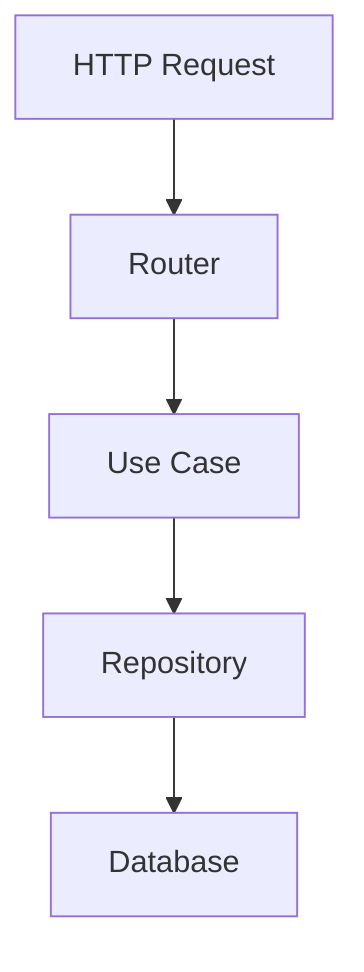

# Documentation Standards

This document defines documentation requirements for this repository.

## Types of Documentation

### 1. README.md
**Purpose**: Project overview and quick start

**Must include**:
- Project description (what it does)
- Quick start instructions
- Installation steps
- Basic usage examples
- Links to detailed docs

**Location**: Repository root

### 2. API Documentation
**Purpose**: Describe public APIs

**Must include**:
- Function/class descriptions
- Parameter descriptions
- Return value descriptions
- Usage examples
- Error conditions

**Location**: In code (docstrings) and/or separate docs/

### 3. Architecture Documentation
**Purpose**: Explain system design

**Must include**:
- High-level architecture
- Key design decisions (ADRs)
- Module interactions
- Data flow diagrams

**Location**: `knowledge/architecture/`

### 4. CP Documentation
**Purpose**: Track changes and decisions

**Must include**:
- proposal.md: Why and what (high level)
- spec.md: What (detailed, behavioral)
- plan.md: How (implementation)
- log.md: Implementation notes and decisions

**Location**: `proposals/XXXX-slug/`

## Docstring Format

### Google Style
Use Google docstring format for Python:

```python
def submit_idea(title: str, description: str, author_id: str) -> Idea:
    """Submit a new idea to the system.

    Args:
        title: The idea title (must be non-empty).
        description: Detailed description of the idea.
        author_id: ID of the user submitting the idea.

    Returns:
        The created Idea entity with generated ID and timestamp.

    Raises:
        EmptyTitleError: If title is empty or whitespace.
        InvalidAuthorError: If author_id is invalid.
    """
    # Implementation
```

### Class Docstrings
```python
class Idea:
    """Represents an idea in the system.

    Ideas have a lifecycle from submission through approval/rejection.
    Status transitions are validated at the domain level.

    Attributes:
        id: Unique identifier for the idea.
        title: The idea title.
        description: Detailed description.
        author_id: ID of the author.
        status: Current status in the lifecycle.
        created_at: Timestamp when idea was created.
    """
```

## Documentation Quality

### Clarity
- Write for the reader, not yourself
- Avoid jargon unless defined
- Use simple language
- Provide examples

### Completeness
- Document all public APIs
- Document edge cases
- Document error conditions
- Document configuration options

### Accuracy
- Keep docs in sync with code
- Update docs when code changes
- Review docs during code review
- Remove outdated docs

### Accessibility
- Use clear headings
- Use code blocks for examples
- Use tables for structured data
- Use diagrams for complex concepts

## README Standards

### Structure
```markdown
# Project Name

Short description (1-2 sentences).

## Quick Start

[3-5 commands to get running]

## Installation

Detailed installation steps.

## Usage

Basic usage examples.

## API Documentation

Link to detailed API docs.

## Architecture

Link to architecture docs.

## Contributing

Link to CONTRIBUTING.md or instructions.
```

### Quick Start
Quick start should:
- Be copy-pasteable
- Work on a fresh machine
- Assume minimal prerequisites
- Include all necessary commands

## Architecture Decision Records (ADRs)

### Format
Use the template in `knowledge/architecture/template/adr.md`.

### Required Fields
- Title
- Status (Proposed, Accepted, Deprecated, Superseded by NNNN)
- Context
- Decision
- Consequences

### Location
`knowledge/architecture/index/NNN_description.md`

Filenames use a three-digit number (`NNN_description.md`); the heading uses the same number with four digits (`# NNNN. Title`).

## Code Comments

### When to Comment
- Explain "why", not "what"
- Document non-obvious algorithms
- Explain workarounds
- Document known issues

### When NOT to Comment
- Don't comment obvious code
- Don't comment instead of refactoring
- Don't leave commented-out code

### Comment Style
```python
# Good: Explains why
# We use exponential backoff to avoid overwhelming the server
retry_with_backoff(request)

# Bad: States the obvious
# Call the request function
request()
```

## Diagrams

### When to Use Diagrams
- Architecture overviews
- Data flow
- Sequence diagrams
- State machines

### Tools
- Mermaid (inline in markdown)
- Draw.io (export as PNG/SVG)
- PlantUML (for complex diagrams)

### Example (Mermaid)


## Review Checklist

When reviewing documentation, check:
- [ ] README is up to date
- [ ] All public APIs have docstrings
- [ ] Docstrings follow Google format
- [ ] Examples are accurate
- [ ] Architecture docs reflect current design
- [ ] ADRs are created for significant decisions
- [ ] No outdated documentation
- [ ] Documentation is clear and accessible

## Tools

### Docstring Linting
Consider using:
- `pydocstyle` for docstring style checking
- `interrogate` for docstring coverage

### Running Checks
```bash
# Check docstring style
pydocstyle app/

# Check docstring coverage
interrogate app/
```

## Generation

### API Docs
Consider using:
- Sphinx for comprehensive docs
- MkDocs for simpler docs
- FastAPI's auto-generated docs (for APIs)

### CLI Help
Ensure CLI tools have:
- `--help` output
- Examples in help text
- Clear parameter descriptions
